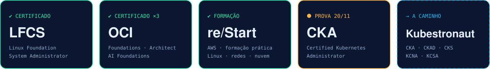

  

  
  
  
  
  
  

> **Infraestrutura em ordem, sem derrubar o que já funciona.**
> Profissional de TI desde 2009, pós-graduado em Cloud Computing e em Redes de Computadores. Ajudo pequenas e médias empresas a colocar servidores, backup e deploy em ordem, e, quando faz sentido, levar tudo para containers e Kubernetes. Este GitHub é o meu laboratório público: as mesmas práticas que aplico com clientes, abertas e documentadas.

### ▸ Stack

  
  
  
  
  
  
  
  
  
  
  
  
  

### ▸ Certificações

LFCS verificável no <a href="https://www.credly.com/badges/e733e9a9-3d30-453c-a079-51df2024a113">Credly</a> · Participante do <a href="https://training.linuxfoundation.org/training/cloud-engineer-itprofessionalprogram/">Cloud Engineer IT Professional Program</a> da Linux Foundation.

### ▸ Projetos

| Projeto | O que tem lá |
|---|---|
| [kubernetes-homelab-terraform-ansible](https://github.com/taciosouzaoliveira/kubernetes-homelab-terraform-ansible) | Cluster Kubernetes com 1 control plane e 2 workers, provisionado com Terraform e configurado com Ansible |
| [homelab-lfcs-cka](https://github.com/taciosouzaoliveira/homelab-lfcs-cka) | Cluster Kubernetes local como código, com Vagrant e KVM/Libvirt |
| [ansible-kubernetes-lab](https://github.com/taciosouzaoliveira/ansible-kubernetes-lab) | Evolução de um provisionamento em shell script para automação com Ansible |
| [SysAdmin](https://github.com/taciosouzaoliveira/SysAdmin) | Laboratórios práticos de administração de sistemas Linux |
| [kubernetes](https://github.com/taciosouzaoliveira/kubernetes) | Manifestos e laboratórios de administração de Kubernetes |
| [engineer.tacio.cloud](https://github.com/taciosouzaoliveira/engineer.tacio.cloud) | Site do laboratório e da consultoria, com domínio próprio, HTTPS e publicação automatizada |

### ▸ Atividade

Gráfico gerado todo dia por uma GitHub Action a partir da API do GitHub (<code>scripts/gerar_svgs.py</code>).

---

<b>Kurumin Tecnologia</b> · consultoria em Linux, automação e Kubernetes · <a href="mailto:contato@kurumintecnologia.com.br">contato@kurumintecnologia.com.br</a>

