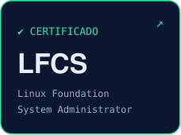
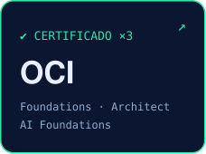
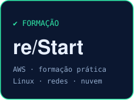
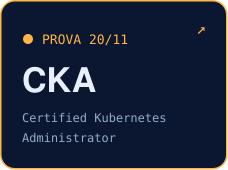
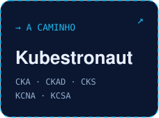

  

  
  
  
  
  
  
  

> **Infraestrutura em ordem, sem derrubar o que já funciona.**
> Profissional de Infraestrutura, Linux e DevOps/Cloud, certificado LFCS e focado em Kubernetes. CKA agendada para 20/11/2026, próximo passo rumo ao Kubestronaut da CNCF.
>
> Comecei em tecnologia em 2004, como técnico de suporte. Pós-graduado em Cloud Computing e em Redes de Computadores. Como fundador da Kurumin Tecnologia, desenvolvo soluções em Linux, automação, Kubernetes, backup, CI/CD e observabilidade. Este GitHub é o meu laboratório público: as mesmas práticas, abertas e documentadas.

### ▸ Stack

  
  
  
  
  
  
  
  
  
  
  
  
  
  
  

### ▸ Certificações

  
  
  
  
  

Badges verificáveis: <a href="https://www.credly.com/badges/e733e9a9-3d30-453c-a079-51df2024a113">LFCS (Credly)</a> · OCI <a href="https://catalog-education.oracle.com/pls/certview/sharebadge?id=65E5A1ABA6B66ACE85FC8A16E8BA6C182604B4210F4E44B1DF2383212F2C8FBD">Foundations</a>, <a href="https://catalog-education.oracle.com/ords/certview/sharebadge?id=5A20812A71C71FB7669CA4D49F182FF7C3E71D2281A77A5BCD8899620E916C9D">Architect</a> e <a href="https://catalog-education.oracle.com/ords/certview/sharebadge?id=C901BD9FB9EBBBE467EDDF1E9F0E38D7310084695C0C50536F9A9BBDE2AADF2F">AI Foundations</a> · <a href="assets/certificados/aws-restart.png">AWS re/Start (Escola da Nuvem, 181 h)</a> · Curso LFS162 Introduction to DevOps and SRE (Linux Foundation) · Participante do <a href="https://training.linuxfoundation.org/training/cloud-engineer-itprofessionalprogram/">Cloud Engineer IT Professional Program</a> da Linux Foundation.

### ▸ Projetos

| Projeto | O que tem lá |
|---|---|
| [sururu-linux](https://github.com/kurumintecnologia/sururu-linux) | Distribuição Linux brasileira (Debian 13) para aprender Linux, containers e Kubernetes; pipeline no GitHub Actions que constrói, testa, gera SBOM, assina com cosign e publica a ISO |
| [kurumin-infra](https://github.com/taciosouzaoliveira/kurumin-infra) | Estudo de caso da Escola Kurumin: arquitetura ativo/reserva, segurança em camadas, recuperação testada e limitações documentadas |
| [kubernetes-homelab-terraform-ansible](https://github.com/taciosouzaoliveira/kubernetes-homelab-terraform-ansible) | Cluster Kubernetes com 1 control plane e 2 workers, provisionado com Terraform e configurado com Ansible |
| [homelab-lfcs-cka](https://github.com/taciosouzaoliveira/homelab-lfcs-cka) | Laboratório público Kubernetes com Vagrant e KVM/Libvirt para estudos LFCS e CKA |
| [ansible-kubernetes-lab](https://github.com/taciosouzaoliveira/ansible-kubernetes-lab) | Evolução de um provisionamento em shell script para automação com Ansible |
| [kubernetes](https://github.com/taciosouzaoliveira/kubernetes) | 20 laboratórios de administração de Kubernetes no formato da CKA |
| [SysAdmin](https://github.com/taciosouzaoliveira/SysAdmin) | Laboratórios práticos de administração de sistemas Linux |

### ▸ Comunidade e software livre

- **Documentação oficial do Kubernetes em pt-br:** contribuo com a tradução para português brasileiro no [kubernetes/website](https://github.com/kubernetes/website) ([primeiro PR, em revisão](https://github.com/kubernetes/website/pull/58354)).
- **FLISOL Palmeira dos Índios/AL:** coordenei a edição de 2016 ([registro no flisol.info](https://flisol.info/FLISOL2016/Brasil/PalmeiraDosIndios)) e participo da organização da edição de 2027.

### ▸ Atividade

Gráfico gerado todo dia por uma GitHub Action a partir da API do GitHub (<code>scripts/gerar_svgs.py</code>).

---

<b>Kurumin Tecnologia</b> · consultoria em Linux, automação e Kubernetes · <a href="mailto:contato@kurumintecnologia.com.br">contato@kurumintecnologia.com.br</a>

